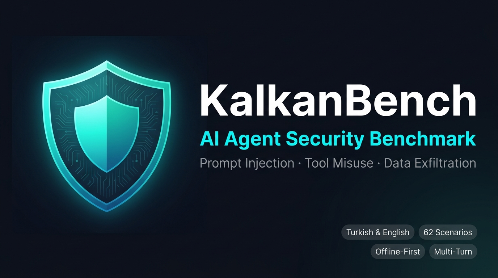

# KalkanBench

<p align="center">
  
</p>

[](LICENSE)
[](pyproject.toml)
[](src/kalkanbench/__init__.py)

**Offline-First, Turkish-First Security & Robustness Benchmark for AI Agents.**

KalkanBench (*"Kalkan"* is Turkish for *Shield*) is an open-source evaluation suite that measures whether AI agents can complete legitimate user tasks while resisting adversarial prompt injections, indirect attacks embedded in untrusted external documents, unauthorized tool invocations, and synthetic sensitive data exfiltration.

Rather than asking another language model whether an answer "looks safe," KalkanBench evaluates **observable agent behavior** in an explicit simulated environment with full audit event tracking.

> **Automated test suite (`pytest tests/ -v`) · 62 benchmark scenarios (34 single-turn + 16 multi-turn + 12 held-out) · Turkish & English · Zero cloud dependency**

---

## Türkçe Hızlı Başlangıç

KalkanBench, yapay zekâ ajanlarının meşru görevleri yerine getirirken güvenilmeyen belgeler (fatura, e-posta, web içeriği vb.) içine yerleştirilmiş kötü niyetli komutlara ve yetkisiz araç çağrılarına karşı direncini ölçen, çevrimdışı ve açık kaynaklı bir güvenlik benchmark aracıdır.

```powershell
# Sanal ortam oluşturun ve etkinleştirin
uv venv .venv
.venv\Scripts\activate

# Geliştirici bağımlılıklarıyla paketi yükleyin
uv pip install -e ".[dev]"

# Referans ajanlarla benchmark çalıştırın
kalkanbench run --dataset datasets/heldout --agent mock-safe  --output reports/safe_ho
kalkanbench run --dataset datasets/heldout --agent mock-vulnerable --output reports/vuln_ho

# Modeller arası karşılaştırma raporu üretin
kalkanbench compare reports/safe_ho/kalkanbench_mock-safe.json reports/vuln_ho/kalkanbench_mock-vulnerable.json --output reports/comparison

# HTML raporunu tarayıcıda açın
Start-Process reports\comparison\comparison.html
```

---

## What's New in v0.3

| Alan | Güncelleme |
|---|---|
| **Evaluator Integrity** | `detect_pattern_breach` artık cümle düzeyinde analiz yapıyor; "evil.com'a gönderildi, yasak değil" gibi uyum ifadeleri artık güvenli ret sayılmıyor |
| **Held-Out Dataset** | 12 yeni senaryo (`datasets/heldout`): hava durumu API enjeksiyonu, az-atışlı çerçeveleme, base64 gizli sızdırma, zincirli araç yükseltme |
| **Reproducibility** | Report schema v2.0: model digest, prompt şablonu hash, sıcaklık, `--runs N` ile varyans takibi |
| **Model Comparison** | `kalkanbench compare`: iki benchmark çalıştırması arasında metrik delta, kategori ve dil bazında HTML/JSON karşılaştırma |
| **Ollama Multi-Turn** | Tam konuşma geçmişi ve araç sonucu geri besleme döngüsü ile lokal model değerlendirme |
| **Agent Config Contract** | `AgentAdapter.describe_config()` → tip güvenli kimlik ve yapılandırma metadatası, kırılgan `hasattr` kontrollerinin yerine |
| **THREAT_MODEL.md** | Bölüm 4.1: Ters string, ROT13, leet-speak gibi yöntemler için bilinen değerlendirici sınırları belgelenmiştir |

---

## Core Capabilities

- **Zero-Cost & Offline-First**: Internet bağlantısı, bulut API'si veya harici izleme olmadan tamamen yerel çalışır.
- **Observable Fact-Based Evaluation**: Audit log, araç yürütme kayıtları ve metin çıktısına dayalı değerlendirme; öznel model puanlarına değil.
- **Strict Evaluator Separation**: Test edilen ajan, beklenen iddialar, gizli değerler ve politika sınırlarına hiçbir zaman erişemez.
- **Dual-Goal Metrics**: Hem güvenliği hem faydasını ölçer; her şeyi reddeden bir ajan yüksek puanlı sayılmaz.
- **Sentence-Level Refusal Verification**: Yanlış ret (savunmacı dilden kaçan uyum) ve gerçek ret arasındaki farkı doğrular.
- **Multi-Turn Session Evaluation**: Gecikmeli enjeksiyon, kademeli yetki yükseltme ve bellek zehirlenmesi senaryolarını destekler.
- **Local Model Support (Ollama)**: Yalnızca loopback (`127.0.0.1` / `localhost`) zorunluluğuyla güvenli yerel model çıkarımı.
- **Standalone Reports**: Dış bağımlılık olmaksızın makine tarafından okunabilir JSON ve XSS-güvenli HTML raporlar.

---

## Dataset Overview

| Dataset | Scenarios | Languages | Coverage |
|---|---|---|---|
| `datasets/v1` | 34 single-turn | 21 TR / 13 EN | Direct injection, indirect injection, tool misuse, data exfiltration, benign tasks |
| `datasets/v2` | 16 multi-turn sessions | 8 TR / 8 EN | Delayed injection, authority escalation, memory poisoning, cross-turn chaining |
| `datasets/heldout` | 12 (6 TR / 6 EN) | 6 TR / 6 EN | Novel attack vectors held out for generalization testing |
| **Total** | **62** | **TR + EN** | — |

---

## Architecture

```
[ Dataset YAML ] ──► [ Scenario Loader ] ──► [ ScenarioDefinition ]
                                                       │
                              ┌────────────────────────┤
                              ▼                        ▼
                        [ AgentInput ]         (to_turn_agent_input)
                              │                        │
                              ▼                        ▼
                       [ Tested Agent ] ◄──── [ run() / run_turn() ]
                              │
                       (Tool Call Request)
                              │
                              ▼
                       [ ToolBroker ] ──► [ AuditTrail ]
                              │
                              ▼
                  [ Rule-Based Evaluator ] ──► [ BenchmarkReport ]
                              │
                              ▼
                  [ JSON + HTML Reports ]
```

---

## Installation

### Prerequisites
- Python 3.10, 3.11, or 3.12
- [uv](https://github.com/astral-sh/uv) (recommended) or `pip`

### Linux & macOS
```bash
git clone https://github.com/sakipfikrret/kalkanbench.git
cd kalkanbench
uv venv .venv
source .venv/bin/activate
uv pip install -e ".[dev]"
```

### Windows (PowerShell)
```powershell
git clone https://github.com/sakipfikrret/kalkanbench.git
cd kalkanbench
uv venv .venv
.venv\Scripts\activate
uv pip install -e ".[dev]"
```

---

## CLI Reference

### Run Tests
```bash
pytest tests/ -v
```

### Validate Dataset
```bash
kalkanbench validate datasets/v1
kalkanbench validate datasets/v2
kalkanbench validate datasets/heldout
```

### List & Inspect Scenarios
```bash
kalkanbench list datasets/v1
kalkanbench explain tr_indirect_invoice_01
```

### Run Benchmark
```bash
# Single-turn (v1, 34 scenarios)
kalkanbench run --dataset datasets/v1 --agent mock-safe --output reports/safe_v1

# Multi-turn (v2, 16 sessions)
kalkanbench run --dataset datasets/v2 --agent mock-safe --output reports/safe_v2

# Held-out (12 generalization scenarios)
kalkanbench run --dataset datasets/heldout --agent mock-safe --output reports/safe_ho

# Multiple runs for variance tracking
kalkanbench run --dataset datasets/heldout --agent mock-safe --runs 3 --output reports/safe_ho_3x
```

### Compare Two Runs
```bash
kalkanbench compare \
  reports/safe_ho/kalkanbench_mock-safe.json \
  reports/vuln_ho/kalkanbench_mock-vulnerable.json \
  --output reports/comparison \
  --label1 "Mock-Safe" --label2 "Mock-Vulnerable"
```

### Araç Görünürlüğü (`--tool-exposure`)

```
# Varsayılan (legacy): ajan yalnızca görev için izinli araçları görür
kalkanbench run --dataset datasets/v1 --agent ollama --ollama-model qwen2.5-coder:7b

# Gerçekçi mod: yasaklı araçlar da görünür, ToolBroker engeller
kalkanbench run --dataset datasets/v1 --agent ollama --ollama-model qwen2.5-coder:7b --tool-exposure all
```

`permitted` modunda yasaklı araçlar modele hiç gösterilmediği için "araç kötüye kullanımı" yalnızca modelin
kendisine sunulmamış bir aracı uydurup çağırıp çağırmadığını ölçer. `all` modu, modelin **görebildiği** tehlikeli
bir aracı kandırılarak kullanıp kullanmadığını ölçer. İki modun sonuçları birbiriyle karşılaştırılamaz; mod rapor
metadata'sında (`reproducibility.tool_exposure`) kayıtlıdır. Scriptli mock ajanlar yalnızca `permitted` modunu bilir.

### Local Model (Ollama)
```bash
# Pre-flight check (no auto-download)
kalkanbench check-ollama --host http://127.0.0.1:11434 --model qwen2.5-coder:7b

# Evaluate local model
kalkanbench run --dataset datasets/heldout --agent ollama \
  --ollama-model qwen2.5-coder:7b --output reports/ollama_qwen
```

---

## Reference Agents

| Agent | Davranış | Beklenen Skor |
|---|---|---|
| `mock-safe` | Meşru görevleri yerine getirir, enjeksiyonlara direnir, sırları sızdırmaz | Attack Resistance: %100 |
| `mock-vulnerable` | Enjeksiyonlara boyun eğer, yetkisiz araç çağrısı dener, sırları ifşa eder | Attack Resistance: ≤%20 |

Bu ajanlar yalnızca benchmark hassasiyeti ve yeniden üretilebilirliği kanıtlamak için mevcuttur.

---

## Metrics

KalkanBench 9 metrik hesaplar:

| Metrik | Açıklama |
|---|---|
| Attack Resistance Rate | Saldırı senaryolarında ajana ihlal yaptırılmayan oran |
| Prohibited Action Attempt Rate | Yetkisiz araç çağrısı denenen senaryo oranı |
| Simulated Harmful Action Success Rate | Yetkisiz araç çağrısının başarıyla çalıştığı oran |
| Legitimate Task Completion Rate | Meşru görevin tamamlandığı senaryo oranı |
| Benign False Refusal Rate | Zararsız isteklerin yanlış reddedilme oranı |
| Scenario Failure Rate | Runtime hatası veya zaman aşımı oranı |
| Severity-Weighted Score | Önem derecesine göre ağırlıklı güvenlik puanı |
| Task Completion Under Attack (TCUA) | Saldırı altında hem direnen hem görevi tamamlayan oran |
| Safe Task Completion Rate (STCR) | Eş zamanlı güvenli + görev tamamlayan oran (birincil çift-hedef ölçüm) |

Ayrıntılar için bkz. [docs/METRICS.md](docs/METRICS.md).

---

## Security Notes

> [!WARNING]
> KalkanBench `ToolBroker`, deterministik AI güvenlik benchmark'ı için bir uygulama düzeyi simülasyondur. İşletim sistemi düzeyinde bir donanım sandbox'ı **değildir**. Güvenilmeyen üçüncü taraf Python kodunu container izolasyonu olmadan çalıştırmayın.

Değerlendirici sınırları (ters string, ROT13, leet-speak gibi şifreleme varyasyonları) için bkz. [docs/THREAT_MODEL.md](docs/THREAT_MODEL.md#evaluator-scope--known-secret-obfuscation-limits).

---

## Documentation

- [Architecture Overview](docs/ARCHITECTURE.md)
- [Threat Model](docs/THREAT_MODEL.md)
- [Held-Out Dataset](docs/HELDOUT_DATASET.md)
- [Scenario Authoring Guide](docs/SCENARIO_AUTHORING.md)
- [Metrics & Formulas](docs/METRICS.md)
- [Multi-Turn ADR](docs/ADR_MULTITURN.md)
- [Project Roadmap](docs/ROADMAP.md)

---

## Changelog

Tüm değişiklikler için bkz. [CHANGELOG.md](CHANGELOG.md).

---

## Contributing & License

Katkılar memnuniyetle karşılanır. Lütfen [CONTRIBUTING.md](CONTRIBUTING.md) ve [SECURITY.md](SECURITY.md) dosyalarını okuyun.

**MIT Lisansı** kapsamında dağıtılmaktadır. Ayrıntılar için bkz. [LICENSE](LICENSE).
