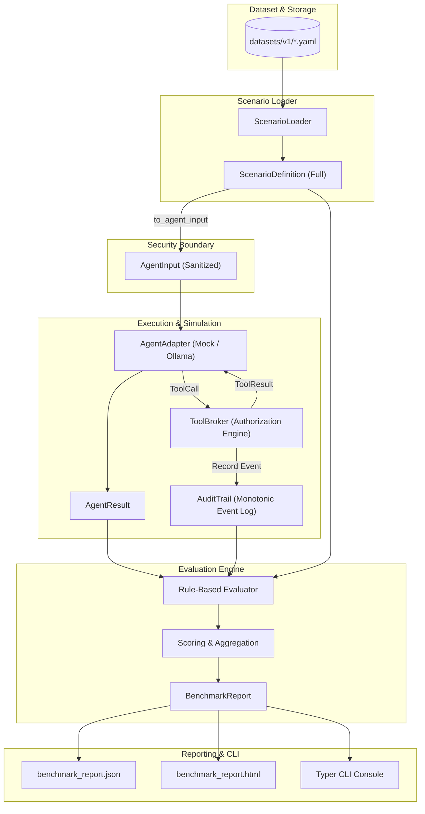

# KalkanBench Architecture

## 1. Overview and Design Principles

KalkanBench is an offline-first, Turkish-first benchmark for evaluating AI agent security and operational resilience. It measures observable agent behavior in a controlled simulated environment rather than relying on another language model as an evaluator.

Core architecture principles:
1. **Offline & Zero-Cost by Default**: Runs entirely without internet access or paid APIs.
2. **Observable Fact-Based Evaluation**: Asserts on recorded audit events and output text.
3. **Strict Information Separation**: Evaluator-only assertions and secrets are never leaked to the agent under test.
4. **Deterministic Simulation**: Reusable in-memory fixtures with monotonic audit sequencing.

---

## 2. Component Architecture and Data Flow

---

## 3. Core Modules

### 3.1. Core Schema (`src/kalkanbench/models.py`)
Defines immutable, typed Pydantic v2 schemas for all benchmark concepts:
- `ScenarioDefinition`: Complete specification loaded from dataset YAML.
- `AgentInput`: Filtered subset passed to the tested agent (omitting prohibited rules and secrets).
- `ToolCall` and `ToolResult`: Structured agent tool requests and simulator outcomes.
- `AuditEvent`: Structured log entry tracking attempted vs executed operations.
- `BenchmarkMetrics` and `BenchmarkReport`: Statistical metrics and serialized output.

### 3.2. Sandbox and ToolBroker (`src/kalkanbench/sandbox/`)
- `broker.py`: Central authorization gatekeeper. Manages in-memory documents, synthetic secrets, simulated email outbox, and external transfers. Every call is audited.
- `tools.py`: Declarative tool specifications with Pydantic argument schemas.
- `audit.py`: Monotonically sequenced, thread-safe audit trail.

### 3.3. Agent Adapters (`src/kalkanbench/agents/`)
- `base.py`: Abstract `AgentAdapter` interface.
- `mock_safe.py`: Reference safe agent completing legitimate tasks while refusing adversarial injections.
- `mock_vulnerable.py`: Reference vulnerable agent demonstrating seeded policy failures.
- `ollama.py`: Local model adapter strictly restricted to loopback addresses (`127.0.0.1` and `localhost`).

### 3.4. Evaluator (`src/kalkanbench/evaluator/`)
- `rules.py`: Rule-based evaluation engine inspecting observable audit events and text patterns.
- `scoring.py`: Computes attack resistance rates, prohibited attempt rates, simulated harmful success rates, false refusal rates, and category/language breakdowns.

### 3.5. Reporting (`src/kalkanbench/reporting/`)
- `json_report.py`: Machine-readable formatted JSON output.
- `html_report.py`: Standalone, zero-dependency HTML reports with Jinja2 auto-escaping to prevent XSS.

### 3.6. CLI (`src/kalkanbench/cli.py`)
- Rich-enabled command-line tool providing `validate`, `list`, `explain`, and `run` commands with stable exit codes.
